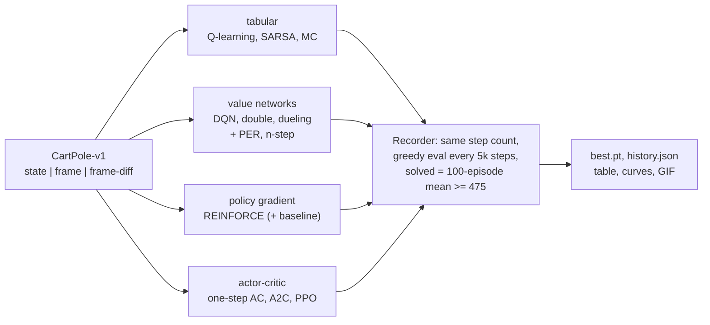
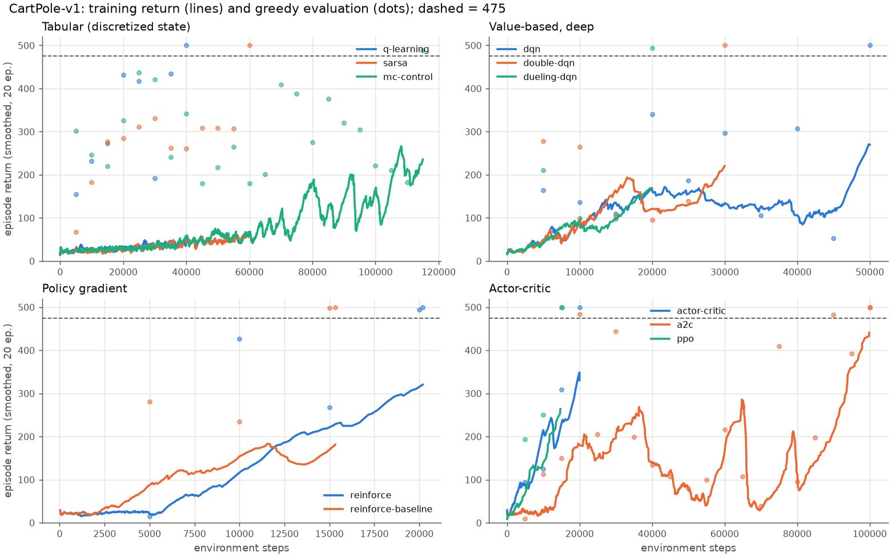
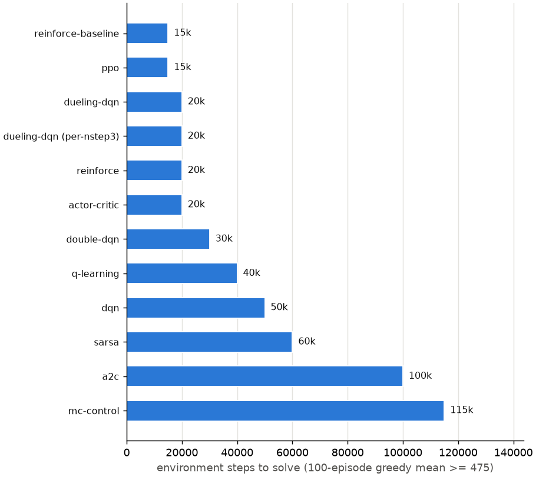
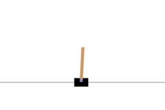
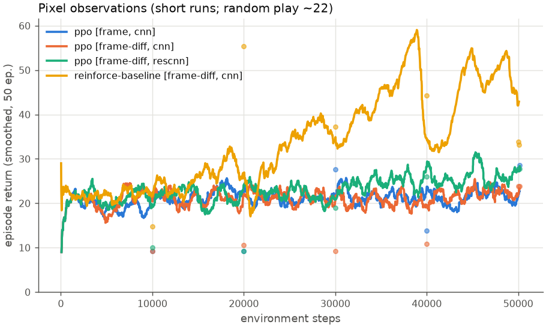

# cartpole-rl

**CartPole solved every way, in one small PyTorch code base built to understand how each
method works: tabular Q-learning, SARSA and Monte Carlo control, DQN with its double /
dueling / prioritized / n-step variants, REINFORCE with and without a baseline, one-step
actor-critic, A2C and PPO, plus CNN policies that learn from rendered pixels. Same
environment, same evaluation, same plots, so the methods can be compared with real numbers.**

[](LICENSE)
[](pyproject.toml)
[](https://pytorch.org)
[](https://gymnasium.farama.org/environments/classic_control/cart_pole/)
[](docs/testing.md)

Every method is one command with defaults that work on a laptop CPU in seconds to minutes,
and every update rule is a few readable lines next to a comment that says *why* it is there.



| method | `--method` | how it works, in one line | code |
|---|---|---|---|
| Q-learning | `q-learning` | Q table on a binned state, TD target `r + gamma max Q(s', .)` | `algorithms/tabular.py` |
| SARSA | `sarsa` | same table, target uses the action actually taken next (on-policy) | `algorithms/tabular.py` |
| Monte Carlo control | `mc-control` | same table, target is the real episode return, no bootstrapping | `algorithms/tabular.py` |
| DQN | `dqn` | Q network + replay buffer + slowly updated target network | `algorithms/dqn.py` |
| double DQN | `double-dqn` | online net picks `a'`, target net evaluates it: less overestimation | `algorithms/dqn.py` |
| dueling DQN | `dueling-dqn` | `Q = V(s) + A(s,a) - mean A` (+ double target) | `networks.QNet` |
| + prioritized replay | `--prioritized` | sample transitions by TD error, importance weights fix the bias | `buffers.PrioritizedReplay` |
| + n-step returns | `--n-step 3` | sum 3 real rewards before bootstrapping | `buffers.NStepCollector` |
| REINFORCE | `reinforce` | after each episode, push up `log pi(a|s)` weighted by normalized reward-to-go | `algorithms/policy_gradient.py` |
| REINFORCE + baseline | `reinforce-baseline` | same, weighted by `G_t - V(s_t)`: same direction, less noise | `algorithms/policy_gradient.py` |
| one-step actor-critic | `actor-critic` | update every step with the TD error as the advantage | `algorithms/actor_critic.py` |
| A2C | `a2c` | 8 parallel envs, 8-step returns, one combined actor + critic + entropy loss | `algorithms/actor_critic.py` |
| PPO | `ppo` | reuse each rollout for many epochs, clip the probability ratio, GAE advantages | `algorithms/ppo.py` |
| pixel observations | `--obs frame` / `--obs frame-diff` | the rendered image (and the difference of two frames) instead of the state | `env.PixelObservation` |
| CNN / residual CNN | `--net cnn` / `--net rescnn` | 3-conv CNN, optionally with a residual block, under any neural method | `networks.CNNBody` |

The equations, shapes and the reason behind each ingredient (replay, target network,
baseline, GAE, clipping, ...) are in [docs/architecture.md](docs/architecture.md).

## Quick start

```bash
git clone https://github.com/benisalla/cartpole-rl && cd cartpole-rl
uv venv .venv && VIRTUAL_ENV=.venv uv pip install -e ".[dev]"   # or: pip install -e ".[dev]"
source .venv/bin/activate

cartpole-train --method ppo --record ppo.gif      # ~30 s on one CPU thread, then a GIF
cartpole-train --method q-learning                # a Q table that balances the pole, ~15 s
cartpole-eval checkpoints/ppo/best.pt             # greedy return over 100 unseen start states
cartpole-compare --methods all                    # every method, one table + curves (~10 min)
```

Swap `--method` for any name in the table; add `--obs frame-diff` to learn from pixels.
`uv` installs the CPU-only PyTorch wheels (configured in `pyproject.toml`); plain `pip` works too.

## Examples

[`examples/`](examples/README.md) holds six short scripts that use the package from Python,
in order: a Q table on the binned state (and a picture of the policy it learnt), DQN variants
flag by flag, REINFORCE with and without a baseline, PPO with a checkpoint round trip and a
GIF, one method per family through the comparison tool, and what the CNN sees in pixel mode.

```bash
python examples/01_tabular_q_learning.py && python examples/04_ppo_and_record.py
```

## Results

These are short CPU runs on one thread, one seed (0), with each method's default settings and
`stop_when_solved`. Their purpose is to show that every method learns and to compare how
it learns. They are not benchmarks: with another seed the ranking of methods that solve
within one or two evaluation intervals (5 000 steps) of each other can swap. The notebook
repeats the comparison over three seeds.

**Protocol** ([docs/evaluation.md](docs/evaluation.md)): greedy actions, fixed start states,
10-episode evaluation every 5 000 environment steps; a candidate at >= 475 is confirmed on
100 more episodes; "steps to solve" is the first confirmed point (so it is a multiple of
5 000). The last columns are a final 100-episode greedy evaluation on start states never seen
before. Wall times were measured on a shared 8-core machine that was busy with other jobs
(the DQN runs in particular ran under heavy load), so compare them within an order of
magnitude, not to the second.

### State observations: every method solves CartPole-v1

| method | params | solved | steps to solve | episodes to solve | time to solve | final greedy return | episodes >= 475 | steps run | wall time |
|---|---|---|---|---|---|---|---|---|---|
| `q-learning` | 1,728 | yes | 40,000 | 1,337 | 4 s | 499.7 +- 3.2 | 99% | 40,000 | 6 s |
| `sarsa` | 1,728 | yes | 60,000 | 1,865 | 6 s | 499.7 +- 3.2 | 99% | 60,000 | 8 s |
| `mc-control` | 1,728 | yes | 115,000 | 2,227 | 12 s | 500.0 +- 0.0 | 100% | 115,000 | 14 s |
| `dqn` | 17,410 | yes | 50,000 | 524 | 156 s | 500.0 +- 0.0 | 100% | 50,000 | 167 s |
| `double-dqn` | 17,410 | yes | 30,000 | 381 | 78 s | 500.0 +- 0.0 | 100% | 30,000 | 86 s |
| `dueling-dqn` | 17,539 | yes | 20,000 | 329 | 42 s | 477.1 +- 46.9 | 75% | 20,000 | 51 s |
| `dueling-dqn (per-nstep3)` | 17,539 | yes | 20,000 | 235 | 49 s | 477.6 +- 44.8 | 76% | 20,000 | 56 s |
| `reinforce` | 17,410 | yes | 20,000 | 343 | 11 s | 478.8 +- 38.3 | 73% | 20,196 | 17 s |
| `reinforce-baseline` | 34,691 | yes | 15,000 | 210 | 5 s | 487.3 +- 29.5 | 84% | 15,324 | 9 s |
| `actor-critic` | 34,691 | yes | 20,000 | 167 | 52 s | 496.3 +- 11.9 | 93% | 20,000 | 59 s |
| `a2c` | 34,691 | yes | 100,000 | 1,223 | 18 s | 500.0 +- 0.0 | 100% | 100,032 | 22 s |
| `ppo` | 34,691 | yes | 15,000 | 183 | 7 s | 479.6 +- 41.8 | 77% | 15,104 | 12 s |





What the runs show:

* **Everything solves, from a 1 728-number table to a 35 k-parameter actor-critic.**
  CartPole is easy enough that the differences are in *how* each method gets there, which
  is the point of comparing them side by side.
* **Policy methods with variance reduction are the most sample efficient here**: PPO and
  REINFORCE + baseline solve after 15 000 steps (about 200 episodes). Plain REINFORCE needs
  20 000; on the curves the baseline version also starts improving much earlier
  (2 500 vs 5 000 steps), which is the variance reduction at work.
* **DQN variants**: plain DQN 50 000 steps, double DQN 30 000, dueling (+ double) 20 000,
  and dueling with prioritized replay and 3-step returns also 20 000 but in fewer episodes
  (235 vs 329). Plain DQN's training return stalls around 130-160 from 15 000 to 45 000 steps
  before climbing; the double and dueling runs do not show that plateau here. One seed cannot
  prove the overestimation story, but it is the behaviour the double target is meant to fix.
* **Tabular methods need more steps but almost no time**: the binned table updates in
  microseconds, so Q-learning solves in 4 s. Q-learning (40 k) beats SARSA (60 k) beats
  Monte Carlo (115 k): bootstrapping propagates value faster than waiting for full returns.
  Look at the gap between the dots and the lines: the greedy policy is already good while the
  training return is still low, because epsilon is still large (the training return
  measures the *exploring* policy).
* **A2C is the unstable one**: its training return collapses three times (around 35 k, 65 k
  and 80 k steps) before it settles; with one gradient step per 64 samples and no clipping
  of the policy change, a single bad update can undo the policy. That is the problem PPO's
  clipped objective was designed for, and PPO solves in 15 k steps with the same network.
* **One-step actor-critic** works (20 k steps) but is the slowest per step of the
  neural methods (two optimizers stepping after every single environment step).
* Final returns just above 475 with 73-84% of episodes at >= 475 (PPO, REINFORCE, dueling)
  mean those runs stopped at the first confirmed solve; with `--no-stop` they keep improving
  (or, for DQN, sometimes unlearn, which is why the best evaluated weights are kept).



*The PPO agent from the table, one greedy episode on an unseen start state (500 / 500 steps).*

### Pixel observations: short runs, learning has only started

Same evaluation, but from rendered frames (`--obs frame` / `frame-diff`, 40 x 80 grey crops),
a CNN of 330 k parameters, 50 000 environment steps each (about 5 minutes; rendering every
step costs more than the network), final greedy evaluation on 20 episodes. Random play
scores about 22.

| method | params | solved | steps to solve | episodes to solve | time to solve | final greedy return | episodes >= 475 | steps run | wall time |
|---|---|---|---|---|---|---|---|---|---|
| `ppo [frame, cnn]` | 330,211 | no | - | - | - | 16.6 +- 9.3 (20 ep.) | 0% | 50,176 | 272 s |
| `reinforce-baseline [frame-diff, cnn]` | 330,611 | no | - | - | - | 37.0 +- 13.7 (20 ep.) | 0% | 50,082 | 315 s |
| `ppo [frame-diff, cnn]` | 330,611 | no | - | - | - | 27.1 +- 10.6 (20 ep.) | 0% | 50,176 | 301 s |
| `ppo [frame-diff, rescnn]` | 335,251 | no | - | - | - | 32.7 +- 15.2 (20 ep.) | 0% | 50,176 | 346 s |



None of these runs is anywhere near solving, which is the honest result for 50 000 steps of
pixel-based RL on a CPU (published pixel CartPole agents train for hundreds of thousands to
millions of steps). What can already be seen:

* **A single frame does not contain the velocities**: PPO on `frame` stays at random level
  (16.6 greedy, training return around 22), as expected for a partially observable problem.
* **Frame differences help, and REINFORCE + baseline is the first to use them**: its training
  return climbs to about 55 (2.5 x random) and its best evaluation reaches 55 at 20 000
  steps, while the PPO runs only start drifting up after 40 000 steps (the residual CNN
  slightly ahead of the plain one, 32.7 vs 27.1). With PPO's pixel settings (4 epochs per
  rollout, lr 3e-4, chosen for speed) it simply has done fewer effective updates.
* The notebook runs the same three PPO configurations for 200 000 steps.

## Repository layout

```
src/cartpole_rl/
  config.py          TrainConfig + working defaults for every method
  env.py             CartPole-v1, pixel observations, state discretizer, vector env
  networks.py        MLP / CNN / residual CNN bodies, Q head (dueling), actor-critic heads
  agents.py          table, Q-network and policy agents behind one act(obs)
  buffers.py         replay, prioritized replay, n-step returns
  algorithms/        tabular.py, dqn.py, policy_gradient.py, actor_critic.py, rollout.py (GAE), ppo.py
  metrics.py         Recorder: step counting, periodic greedy eval, solved check, best weights
  evaluate.py        shared evaluation + cartpole-eval
  train.py           train() + cartpole-train
  compare.py         cartpole-compare: table + figures
  play.py            GIF / MP4 recording (cartpole-play)
  viz.py             curves and bar charts
tests/               52 pytest tests, about 40 s on one CPU thread
docs/                architecture, environment, training, evaluation, testing
examples/            six numbered scripts
notebooks/           build_notebook.py -> train_colab_kaggle.ipynb
scripts/             export_results.py: copy run results into assets/
assets/              figures and tables from the local runs below
legacy/              the original coursework notebooks + what was fixed
```

## Documentation

* [docs/architecture.md](docs/architecture.md): every method's update rule, loss and the why
* [docs/environment.md](docs/environment.md): CartPole as an MDP, terminated vs truncated, observation modes, binning
* [docs/training.md](docs/training.md): commands, default hyper-parameters and why, speed
* [docs/evaluation.md](docs/evaluation.md): the shared protocol, what "solved" means here
* [docs/testing.md](docs/testing.md): what the tests check

## Notebook (Kaggle / Colab)

[`notebooks/train_colab_kaggle.ipynb`](notebooks/train_colab_kaggle.ipynb) installs the
package from GitHub and goes through the MDP, returns, value vs policy methods, then each
family with its update rule explained in markdown before the code that trains it, the
full comparison over three seeds, and longer pixel runs. It is generated from
`notebooks/build_notebook.py`.

## Legacy notebooks

[`legacy/`](legacy/README.md) keeps the original coursework notebooks (REINFORCE with a fully
connected policy, a CNN on rendered frames, a residual CNN on frame differences) unchanged,
with a table of the 15 bugs found in them and how this package handles each one (for
example: returns misaligned with log-probabilities in the frame-difference training, an
epsilon-random action mixed into a policy gradient, and a 15 degree rotation augmentation
on images whose pole angle is the state).

## License

MIT, see [LICENSE](LICENSE).
