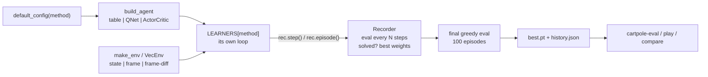

# Architecture: every method, its update rule, and why

This page walks through the code base and then through each method: what it estimates, the
exact loss or update in the code, and the reason each ingredient is there. The code is short
on purpose; every section points to the file to read next to it.

```
src/cartpole_rl/
  config.py        TrainConfig + known-good defaults per method (METHOD_DEFAULTS)
  env.py           CartPole-v1, pixel observations, Discretizer, VecEnv
  networks.py      MLP / CNN / residual CNN bodies; QNet (dueling) and ActorCritic heads
  agents.py        TabularAgent, QAgent, PolicyAgent: one act(obs) interface
  buffers.py       replay buffer, prioritized replay, n-step collector
  algorithms/
    tabular.py         q-learning, sarsa, mc-control
    dqn.py             dqn, double-dqn, dueling-dqn (+ prioritized, n-step flags)
    policy_gradient.py reinforce, reinforce-baseline
    actor_critic.py    actor-critic (one-step), a2c
    rollout.py         rollout collection + GAE, shared by a2c and ppo
    ppo.py             ppo
  metrics.py       Recorder: step / episode counting, evaluation, solved check, best weights
  evaluate.py      the shared greedy evaluation (+ cartpole-eval)
  train.py         train(cfg) and cartpole-train
  compare.py       cartpole-compare: several runs -> table + figures
  play.py          GIF / MP4 recording (cartpole-play)
  viz.py           curves and bar charts
```



Every algorithm is a function `learn(cfg, agent, rec)` with its own loop, because the loops
really are different (per step, per episode, per rollout). What they share is the
`Recorder`: they call `rec.step()` after each environment step and `rec.episode(ret)` at the
end of each episode, and loop `while not rec.done`. That is how all methods get the same
step counting, evaluation and stopping rule without a common base class.

## Value methods versus policy methods

* A **value method** learns `Q(s, a)`, the expected return after taking `a` in `s`, and acts
  greedily on it. The policy is implicit: `pi(s) = argmax_a Q(s, a)`. It can learn from any
  data (off-policy), which allows replay buffers. Exploration has to be added by hand
  (epsilon-greedy).
* A **policy method** learns `pi_theta(a|s)` directly and changes it in the direction that
  makes good actions more likely. Exploration is built in (the policy is stochastic), but the
  gradient needs data from the current policy (on-policy), so data is used once or a few times.
* An **actor-critic** does both: a policy (actor) plus a value function (critic) used only to
  judge the actor's actions with less noise than raw returns.

## Tabular methods (`algorithms/tabular.py`)

State -> integer with the `Discretizer` (864 states, see [environment.md](environment.md)),
`Q` is a `864 x 2` numpy array, initialised to 0. Behaviour is epsilon-greedy with epsilon
going linearly from 1.0 to 0.02 over 150 000 steps, step size `alpha = 0.1`.

| method | update after each step `(s, a, r, s')` | idea |
|---|---|---|
| `q-learning` | `Q[s,a] += alpha (r + gamma max_a' Q[s',a'] - Q[s,a])` | learn the greedy policy while behaving epsilon-greedily (off-policy TD) |
| `sarsa` | `Q[s,a] += alpha (r + gamma Q[s',a'] - Q[s,a])`, `a'` the action actually taken next | learn the value of the epsilon-greedy policy itself (on-policy TD) |
| `mc-control` | at episode end, for each `t`: `Q[s_t,a_t] += alpha (G_t - Q[s_t,a_t])` | no bootstrapping: the target is the real return |

*Why TD (bootstrapping) vs Monte Carlo:* TD uses its own estimate of the next state as part
of the target, so information flows one step per update but with low variance; MC uses the
true return, unbiased but very noisy because one episode's return depends on hundreds of
random actions. *Why SARSA is "careful":* its target includes the occasional random action,
so states where one random push is fatal get lower values; Q-learning's `max` ignores that.
*Why the tie-break is random:* at the start all Q values are 0; `argmax` would always pick
action 0 and the agent would push left forever.

## Deep value methods (`algorithms/dqn.py`, `buffers.py`, `networks.QNet`)

`QNet`: MLP 4 -> 128 -> 128 -> 2 (17 k parameters). Each environment step: act
epsilon-greedily (1.0 -> 0.02 over 15 000 steps), store the transition, and every 2 steps
(after 1 000 warm-up steps) take one gradient step on a random batch of 64 from the last
50 000 transitions:

```
y   = R + discount * (1 - terminated) * Q_target(s', a*)
L   = mean_i  w_i * Huber(Q(s_i, a_i) - y_i)
Q_target <- 0.995 Q_target + 0.005 Q          (Polyak averaging after every gradient step)
```

| variant | `a*` / head | why |
|---|---|---|
| `dqn` | `a* = argmax_a Q_target(s', a)` | the max of noisy estimates is biased upward: errors that happen to be positive get picked |
| `double-dqn` | `a* = argmax_a Q(s', a)` (online net picks, target net evaluates) | the two nets' errors are not the same, so the overestimation mostly cancels |
| `dueling-dqn` | `Q = V(s) + A(s,a) - mean_a A(s,a)` (+ double target) | V is learnt from every transition whatever the action; in CartPole both actions are often about equal, so most of what matters is V |
| `--prioritized` | sample `i` with `p_i ~ (\|delta_i\| + 1e-6)^0.6`, weights `(N p_i)^-beta`, beta 0.4 -> 1 | spend updates where the error is large; the weights undo the sampling bias |
| `--n-step N` | `R = sum_{k<N} gamma^k r_{t+k}`, `discount = gamma^N` | rewards travel N steps back per update instead of one |

Why each ingredient: the **replay buffer** breaks the correlation between consecutive
states (SGD assumes roughly independent samples) and reuses each transition many times; the
**target network** stops the target from moving with every gradient step (otherwise the net
chases its own tail); the **Huber loss** keeps one surprising transition from producing a huge
gradient; `discount` is stored per transition so that the shorter n-step tails at the end of
an episode use the right power of gamma.

## Policy gradient (`algorithms/policy_gradient.py`)

`ActorCritic(critic=False)`: an MLP that outputs two logits. One update per episode:

```
G_t   = r_t + gamma G_{t+1}                                   (reward-to-go)
A_t   = normalize(G_t)                     reinforce
A_t   = normalize(G_t - V(s_t))            reinforce-baseline, with V fit to G_t by MSE
L_pi  = - mean_t log pi(a_t|s_t) A_t  - c_ent mean_t H[pi(.|s_t)]
```

*Why it works:* `grad log pi(a|s)` points toward making `a` more likely in `s`; weighting it by
how good the outcome was makes good actions more likely and bad ones less. *Why
reward-to-go and not the whole return:* an action cannot affect rewards that came before it,
so those only add noise. *Why normalize:* it keeps the step size the same whether the episode
lasted 20 or 500 steps, and makes roughly half the actions "better than average". *Why a
baseline:* subtracting `V(s)` does not change the expected gradient but removes the part of
the return that was going to happen anyway from that state; the gradient then only reacts to
what the action changed.

## Actor-critic (`algorithms/actor_critic.py`)

`actor-critic`, one step at a time, one env (separate actor and critic MLPs and optimizers,
learning rates 5e-4 and 2e-3):

```
delta    = r + gamma (1 - terminated) V(s') - V(s)     (TD error = advantage estimate)
L_critic = delta^2
L_actor  = - log pi(a|s) * delta.detach()
```

*Why:* REINFORCE waits for the episode to end and uses a noisy return; here the critic
answers immediately "was that better than I expected?". Lower variance, but biased by how
wrong `V` is, and every update uses a single, highly correlated sample, so it is the least
stable method in the repo.

`a2c`: the same with 8 envs stepped in parallel, 8 steps each, one update per 64 steps with
one combined loss (one Adam, gradient norm clipped at 0.5):

```
L = - mean(log pi(a|s) A) + 0.5 mean((V(s) - R)^2) - 0.01 mean(H[pi])
```

Advantages come from GAE with lambda = 1, i.e. 8-step returns bootstrapped from `V`.
*Why the parallel envs:* the 64 samples come from 8 different episodes at different
moments, so the batch is far less correlated than 64 consecutive steps; it replaces the
replay buffer of DQN without storing anything. *Why the entropy bonus:* it keeps the policy
from becoming deterministic before it has found good behaviour.

## GAE (`algorithms/rollout.py`)

```
delta_t = r_t + gamma (1 - done_t) V(s_{t+1}) - V(s_t)
A_t     = delta_t + gamma lambda (1 - done_t) A_{t+1}
R_t     = A_t + V(s_t)            (critic target)
```

`lambda` slides between the one-step TD advantage (`lambda = 0`: low variance, biased by V)
and the Monte Carlo advantage (`lambda = 1`: unbiased, noisy). Truncations add
`gamma V(final_obs)` to the reward and are then treated as `done`, so the value is
bootstrapped there and not cut to zero.

## PPO (`algorithms/ppo.py`)

8 envs x 32 steps = 256 samples per rollout, GAE with gamma 0.98, lambda 0.8. Then 20
epochs over the batch in mini-batches of 256:

```
ratio  = exp(log pi(a|s) - log pi_old(a|s))
L_clip = - mean( min(ratio A, clip(ratio, 0.8, 1.2) A) )     A normalized per mini-batch
L      = L_clip + 0.5 mean((V - R)^2) - c_ent mean(H)
```

learning rate 1e-3 decaying linearly to 0. *Why:* A2C uses each sample once; PPO wants to
take many gradient steps on the same batch, but after a few steps the policy is no longer the
one that collected the data, and pushing further on stale advantages can wreck it. The
`min(..., clip(...))` removes any gain from moving the ratio outside `[0.8, 1.2]`: for a good
action (`A > 0`) the objective stops increasing once it is 20% more likely than before, for a
bad one once it is 20% less likely. It is a cheap stand-in for TRPO's KL-divergence trust
region. `clip_fraction` in the logs says how often the clip was active.

## Networks (`networks.py`)

| body | input | layers | output |
|---|---|---|---|
| `mlp` | `(B, 4)` | Linear 4->128, ReLU, Linear 128->128, ReLU | `(B, 128)` |
| `cnn` | `(B, C, 40, 80)` | Conv 5x5/2 C->16 `(16, 18, 38)`, Conv 5x5/2 16->32 `(32, 7, 17)`, Conv 3x3 32->32 `(32, 5, 15)`, flatten 2400, Linear -> 128 | `(B, 128)` |
| `rescnn` | same | as `cnn` with a residual block `relu(x + conv(relu(conv(x))))` after the first conv | `(B, 128)` |

Heads output **logits**, never probabilities, and the policy uses `Categorical(logits=...)`,
which computes `log_softmax` stably (the original notebooks did `log(softmax(x))`, which can
reach `log(0)`). The policy layer is initialised with small weights (orthogonal, gain 0.01)
so every method starts from a near-uniform policy. With state inputs the actor and the critic
have separate bodies (their gradients do not interfere); with pixels they share the CNN,
which halves the cost of the convolutions.

## Agents (`agents.py`)

Everything the outside world needs from a trained agent is `act(obs, greedy=True)`,
`state_dict()` and `load_state_dict()`. A Q table, a Q network and a policy network all
provide that, so evaluation, recording, checkpoints and comparison never care which
algorithm produced the agent.
